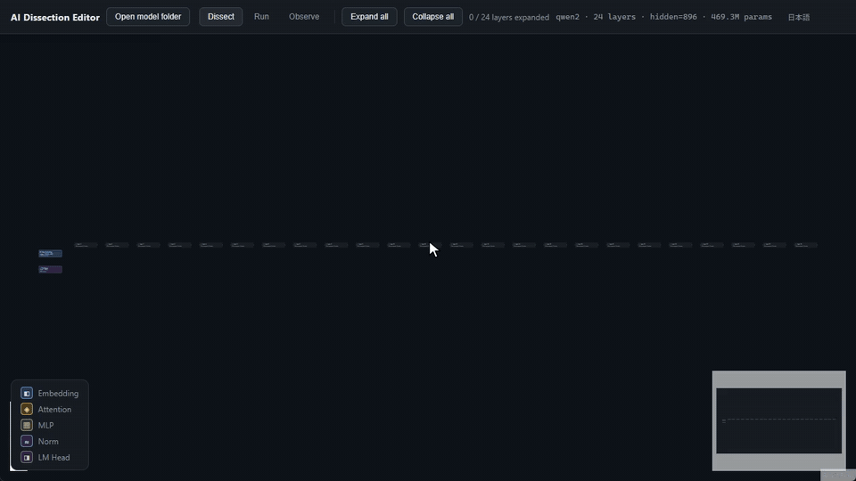

# AI Dissection Editor（AI解剖エディタ）

**ローカルLLMを開いて、中身を部品として扱うデスクトップアプリ。**

Hugging Face形式（safetensors）のローカルモデルを読み込み、内部構造（埋め込み・Attention・MLP・正規化層）をノードグラフとして表示します。そのうえで次のことができます。

- **繋ぎ替える**: 層の順序入れ替え・スキップ・分岐・合流を自由に組み、そのグラフのまま文章を生成する
- **観察する**: Attentionヒートマップ、活性化値の統計、トークンごとの影響度、層ごとの「意味の変遷」(logit lens風)
- **操る**: 残差ストリームに方向ベクトルを足したり取り除いたりして(Activation Steering、迎合・拒否の方向)、元のモデルとの出力差を並べて比べる

ComfyUIやLangFlowのような既存のノード系ツールは、モデルを「外から呼んで」繋ぐものがほとんどです。このツールはモデルを「開いて」、層そのものをノードとして扱います。

> **現状: 個人開発の初期版です。使った感想を募集しています。** 下に書いたことはすべて開発者の手元(Windows、Qwen2.5-0.5B-Instruct)で動作確認済みです。機能を増やす前に「これは誰かの役に立つのか」を確かめたくて公開しました。試してもらえたら、動いたこと・壊れたこと・何に使えそうかを、ぜひ教えてください([フィードバック](#フィードバック)参照)。



## できること

| タブ | 機能 | 内容 |
| --- | --- | --- |
| **解剖** | 構造ビューア | チェックポイント内の全テンソルを役割ラベル付き・層ごとに表示。safetensorsのヘッダーだけを読むので、数GBのモデルでも一瞬で開く |
| **実行** | グラフ実行エンジン | Attention/MLPブロックをドラッグで繋ぎ替え(入れ替え・スキップ・分岐・合流)、そのまま生成。KVキャッシュ、Temperature/Top-k/Top-p、Repetition penalty、no-repeat n-gram、チャットテンプレートに対応 |
| **観察** | 内部状態 | Attentionヒートマップ(ヘッド別・平均)、ブロックごとの活性化値統計(線形/対数スケール) |
| | Prompt Sensitivity Map | 入力トークンを1つずつ削除・置換し、次トークン分布のKLダイバージェンスで影響度を測る |
| | Token Journey | 各ブロックを通過した時点の隠れ状態に最も近い単語を追跡 |
| | Multi-Model Battle View | 同じ入力を2つのグラフ/モデルに通して並べて比較 |
| | Neuron Search / Layer Ablation Wizard | 入力に反応するニューロンを探す/層を無効化して影響を測る |
| | Activation Steering Studio | 対照プロンプト群の平均差分でステアリングベクトルを作り、選んだ層に適用。生成文とKLダイバージェンスで比較 |
| | 迎合・拒否チューナー | 「同意しがち」「断りがち」の方向のプリセット。加算と方向除去の両方に対応 |
| | Live Slider | ステアリングの強さをスライダーで動かし、出力の変化を見る(試験的) |

推論エンジンはPyTorchで自前実装しています(RMSNorm、RoPE、GQA Attention、SwiGLU MLP)。`transformers`には依存していないので、グラフを自由に組み替えられます。

### このツールで観察できたこと

いずれもQwen2.5-0.5B-Instruct(24層)での結果です。

- **ステアリングは5層より1層。** 「ありがとう」と「最悪だ」の差分ベクトルを5層に足すと、scale=1でも生成が反復に崩壊しました。中間の1層(13層目)にscale=1で足すと、崩壊せずに口調が変わりました(感嘆符が増え、「歓迎！」が出てくる)。効果は残差ストリームを通じて累積します
- **拒否の方向を1層から除去しても、拒否は残る。** 全層から除去すると拒否が消え、[Arditi et al. 2024](https://arxiv.org/abs/2406.11717)の報告と一致しました。逆に方向を足すと、無害な依頼まで断るようになりました
- **Massive Activationsがはっきり見える。** 活性化値のstdが2層目で跳ね上がり、20層目まで16〜17程度を保ったあと急減しました。[Sun et al. 2024](https://arxiv.org/abs/2402.17762)の報告と一致します
- **疑問文を決めているのは「？」。** 「こんにちは、元気ですか？」の文末の「？」を消すと次トークン分布が最も大きく動きました(KL 5.73、ほかのトークンは0.04〜0.44)

## はじめかた

動作確認済みの環境は **Windows**・**Qwen2.5-0.5B-Instruct**・CPUです。macOSとLinuxでも動くはずですが、まだ試せていません(報告歓迎)。

**必要なもの:** Node.js 22 LTS、Python 3.10以上、Git、小型モデル用の空き容量約2GB

```bash
git clone https://github.com/Q-1209/-ai-dissection-editor.git ai-dissection-editor
cd ai-dissection-editor

# 1. Python側(0.5BモデルならCPU版PyTorchで十分)
pip install torch --index-url https://download.pytorch.org/whl/cpu
pip install -r requirements.txt

# 2. 試し用の小型モデルをダウンロード
pip install -U huggingface_hub
hf download Qwen/Qwen2.5-0.5B-Instruct --local-dir models/Qwen2.5-0.5B-Instruct

# 3. アプリ
npm install
npm run electron:dev
```

アプリは `python3`（Windowsでは `python`）を使います。PyTorchを入れたPythonの名前や場所が違う場合は、起動前に `PYTHON_BIN` を指定してください。

```powershell
$env:PYTHON_BIN = "C:\path\to\python.exe"   # PowerShell
# set PYTHON_BIN=C:\path\to\python.exe        # コマンドプロンプト
npm run electron:dev
```

起動したら「モデルフォルダを開く」で `models/Qwen2.5-0.5B-Instruct` を選びます。

### 対応モデル

| アーキテクチャ | 状態 |
| --- | --- |
| Qwen2 / Qwen2.5(密結合) | ✅ 実重みで動作確認済み(Qwen2.5-0.5B-Instruct) |
| Llama系の密結合モデル(Llama、旧世代の密結合Mistral) | 🟡 動くはず(ダミー重みで構造検証済み、実重みは未確認) |
| Gemma 2 / 3 | 🟡 構造ビューアのみ対応。実行エンジンは未対応 |
| MoE(Mixtral、最新のMistral/Gemma)、Mamba/SSM、マルチモーダル | ❌ 未対応 |

対応形式はsafetensorsのみです(`.bin`のpickle形式は不可)。量子化dtypeは未検証です。

## 責任ある使い方

ステアリング・拒否チューナーは、公開されている解釈可能性研究と同じく、モデルの挙動を**観察し理解する**ための機能です。小型ローカルモデルから拒否の方向を除いても能力は上がりません。わかるのは、その挙動がどこに宿っているかだけです。他人に提供するモデルの安全機構を外す目的には使わないでください。読み込むモデルのライセンスも守ってください。

## 開発

```bash
python -m pytest python/tests   # ロジックのテスト(numpy)。torchがあればend-to-endテストも実行
npx tsc -b && npx vite build    # UIの型チェック・ビルド
```

Electronのメインプロセスが、Pythonのエントリポイント(`python/*.py`)を標準入出力のJSONで呼び出す構成です。推論エンジンは `python/inference/` にあります。設計判断や、開発中に踏んだバグの記録は [docs/DEVLOG.ja.md](docs/DEVLOG.ja.md) にまとめています。

## フィードバック

このプロジェクトを続ける価値があるか、どの方向に伸ばすべきかを知りたいと思っています。特に助かるのは次の3つです。

1. **試して[「使ってみた」Issue](../../issues/new?template=feedback.yml)を立てる。** 一言で十分です(「インストールできた」「Attention表示が面白い」「Llama-3.2-1Bでステアリングが落ちた」など)
2. **不具合を[バグ報告テンプレート](../../issues/new?template=bug_report.yml)で報告する**
3. **次に対応してほしいモデルを教える**

Pull Requestも歓迎します。大きな変更は、先にIssueで相談してもらえると助かります。

## 今後の予定(暫定)

反応しだいで、次は英語UI、Llama/Mistralの実重み検証、重みの直接編集の順に進める予定です。その先にはLoRA学習、モデル差分・監査ツール、MoE対応も考えていますが、順番はフィードバックで決めます。

## ライセンス

[MIT](LICENSE) © Q-1209

[English README](README.md)
